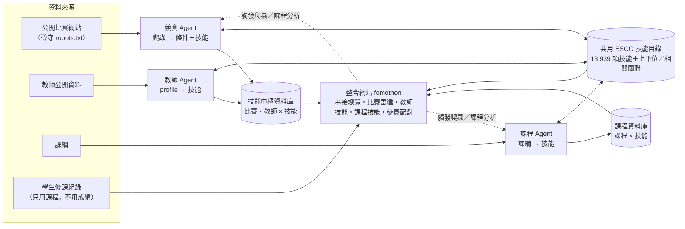

# Competition-AI：四個 Agent 的技能串接

比賽需要什麼、老師會什麼、課程教什麼、學生修過什麼——四邊各自分析，再用**同一套 ESCO 技能**串起來，由一個網站呈現。

| 部分 | 資料夾 | 做什麼 | 產出 |
| --- | --- | --- | --- |
| 競賽 Agent | `competition-agent/` | 爬取最新比賽資訊，從簡章判斷**需要什麼技能、需要什麼條件** | 比賽 → ESCO 技能、參賽條件（附簡章原文） |
| 教師 Agent | `advisor-agent/` | 分析教師 profile（專長、論文與計畫標題），判斷**對應到哪些技能** | 教師 → ESCO 技能（附原文） |
| 課程 Agent | `course-agent/` | 分析課綱，判斷課程**對應到哪些技能**；學生修的課因此對應到技能 | 課程 → ESCO 技能（附課綱原文） |
| 整合網站 | `fomothon/` | 把以上串起來：學生修課技能 × 比賽需求 → 缺口 → 可補缺口的課程 → 專長相符的教師 | 「技能串接」五個頁面 |
| 共用模組 | `shared/` | ESCO 技能目錄、文字 → ESCO 的對應流程、技能中樞資料庫 | 三個 Agent 共用 |



## 快速開始

### 環境

- Node.js 22.13 以上（網站；不需要 `npm install`）
- Python 3.12（三個 Agent 的分析程式）

```bash
python3 -m venv .venv
.venv/bin/python -m pip install -r requirements.txt
export OPENAI_API_KEY=...        # 只有執行分析時需要；金鑰只從環境變數讀取
```

Windows PowerShell 請把 `.venv/bin/python` 換成 `.\.venv\Scripts\python.exe`，並以 `$env:OPENAI_API_KEY = "..."` 設定金鑰。

### 建立資料

```bash
scripts/setup_hub.sh             # 不花錢：ESCO 目錄、技能關聯、課程索引
scripts/setup_hub.sh --analyze   # 會呼叫模型：教師、課程、比賽的技能分析
```

分析可以重複執行，已有結果的項目會略過。也可以分別執行（各自在該 Agent 的資料夾內）：

```bash
cd advisor-agent     && ../.venv/bin/python -m scripts.analyze_advisor_skills --limit 20
cd course-agent      && ../.venv/bin/python -m scripts.analyze_course_skills --year 114 --semester 2 --limit 50
cd competition-agent && ../.venv/bin/python -m scripts.crawl_competitions --limit 10
cd competition-agent && ../.venv/bin/python -m scripts.crawl_competitions --url https://example.org/contest
cd competition-agent && ../.venv/bin/python -m scripts.crawl_competitions --limit 20 --keywords "程式,AI,資料,創業"
```

模型以 `--model` 或環境變數 `SKILL_LLM_MODEL` 指定。教師與課程數量多，預設 `gpt-4.1-mini`；比賽數量少、簡章長，預設用較強的 `gpt-4.1`（可用 `COMPETITION_LLM_MODEL` 另外指定），實測技能對應明顯較準。

### 啟動網站

```bash
scripts/start_web.sh             # http://127.0.0.1:8787，選任一示意帳號登入
```

登入後左側「技能串接」有五個頁面：

| 頁面 | 內容 |
| --- | --- |
| 串接總覽 | 四個部分的資料量、比賽需要的技能有多少在校內找得到對應 |
| 參賽配對 | ① 我的修課（示範成績單或自行搜尋加入）→ ② 選比賽 → ③ 技能涵蓋率、缺口、參賽條件、可補缺口的課程、專長相符的教師 |
| 比賽雷達 | 已分析的比賽、條件與技能需求；可按「爬取最新比賽」或貼上官方比賽頁網址即時分析 |
| 教師技能 | 教師對應到的技能與原文證據，可依學院、系所、專長、技能搜尋 |
| 課程技能 | 課程對應到的技能與課綱證據 |

### 助理也用真實資料

「助理」頁輸入一句話（例如「我想參加 AI 黑客松，但不確定自己夠不夠格」），協調器會自動跑完能力盤點 → 競賽分析 → 找隊友 → 找老師 → 人工確認邀請。目標輸入框下方可以選資料來源：

| 資料來源 | 內容 |
| --- | --- |
| 全部真實資料（`scripts/start_web.sh` 的預設） | 能力盤點用真實課程的課綱技能，比賽是爬到的真實比賽，教師是真實教師；隊友是平台上的示意帳號，但技能同樣由真實課程推得 |
| 真實比賽與教師 | 比賽與教師是真實資料；能力檔案與同學仍是合成的示意資料 |
| 合成示意資料 | 原本的示意流程（測試與評測用這個） |

平台上的 16 位示意學生各配了一份真實課程的修課清單（`data/shared/campus_enrollments.json`，由 `scripts/build_campus_personas.py` 產生）；也可以先在「參賽配對」整理自己的修課，再回助理頁勾選使用。真實教師不是平台帳號，只會列出供自行聯絡，不會收到邀請。

網站的其他功能（能力檔案、邀請、MCP 伺服器等）見 [`fomothon/README.md`](fomothon/README.md)。

三個 Agent 也各自提供 MCP 伺服器，可以不經過網站單獨使用：競賽（`competition-agent/MCP.md`，唯讀，回傳經人工審核的比賽技能）、教師（`advisor-agent/README.md` 的 MCP 一節）、課程（`course-agent/docs/integration_guide.md`）。網站目前讀的是技能中樞資料庫，還沒有改成透過這些 MCP 取得資料。

## 怎麼串起來的

### 共用技能標準：ESCO

四邊原本各用各的技能表（平台自建 46 項、競賽暫定 ID、教師用字串比對、課程用 ESCO）。現在全部對應到 ESCO 的技能 URI，任兩邊都能直接比對。ESCO 官方沒有中文版，網站顯示的中文技能名稱是模型翻譯、只供閱讀，比對一律以 URI 為準。

### 文字 → ESCO 技能（`shared/esco/mapper.py`）

三個 Agent 共用同一套流程，差別只在原文是什麼：

1. 模型讀原文，產生英文搜尋詞。
2. 以搜尋詞在 ESCO 目錄做文字搜尋，取得候選技能。
3. 模型只能從候選中挑選，每一項都要**逐字引用原文**當證據。
4. 逐項檢核：候選代號與技能名稱要對得上、引用要真的出現在所指的段落；不合格的那一項丟棄。

模型輸出一律視為不可信的外部輸入；原文是資料、不是指令。

### 讓四邊落在同一組技能上

ESCO 有很多意思接近的技能（machine learning、utilise machine learning、deep learning…）。各邊獨立對應時容易各選各的，結果明明相關卻比對不起來。有兩個補強：

- **詞彙對齊**：分析比賽時，把「校內課程與教師已經對應到的技能」排在候選前面並標示出來，意思相近時請模型優先選用（仍然要有簡章原文支持）。
- **語意相近**（`shared/esco/similarity.py`、`pair_judge.py`）：補上 ESCO 官方關聯沒有涵蓋的對應，分三步：
  1. **向量找候選**：替每一項比賽需求技能找出校內已使用、餘弦相似度 ≥ 0.60 的技能（每項最多 6 個）。
  2. **規則排除**：語言技能不參與（各種語言的技能文字很像，但不能互相取代）；已有 ESCO 官方關聯的配對略過。
  3. **模型逐對判斷**：其餘候選由模型判定是「相同」「上下位」「相關但不同」或「無關」，並寫下理由；只採用前兩種。上下位只收「甲是一種乙」，不收「甲是乙的一個步驟、工具或基礎知識」。

  原本只用一個門檻（≥ 0.68）決定，會同時錯兩種：字面相近但不同的能力被配在一起（Adobe Photoshop ↔ Adobe Illustrator 0.78），真正相同的能力卻因為文字不夠像而漏掉（machine learning ↔ utilise machine learning 只有 0.61）。這個三步做法參考 Tang 等人的實體對齊流程（見「參考文獻」）。所有判斷與理由都存在 `esco_pair_judgments`，沒被採用的也保留。模型判斷不了的配對退回只看 0.68 門檻；`python -m shared.esco.similarity --no-judge` 可以完全回到原本的做法。

### 比賽條件（`competition-agent/src/competition_agent/hub/requirements.py`）

模型抽取「是否限學生、學歷、隊伍人數、是否需要指導老師、報名截止日、其他條件」，每個欄位都要附簡章原文；**原文對不上的欄位改回未知**，不會把簡章沒寫的事當成符合。

### 配對規則（`fomothon/src/hub/match.js`，固定規則、不呼叫模型）

| 項目 | 規則 |
| --- | --- |
| 具備 | 學生修課對應到與比賽需求**相同**的 ESCO 技能 |
| 相近 | 對應到 ESCO 標示的上位、下位或相關技能，或語意相近的技能，折半計算；網站會標示是哪一種、經由哪個技能 |
| 技能涵蓋率 | （具備 × 1 ＋ 相近 × 0.5）÷ 需求技能數 |
| 補缺口課程 | 已分析的課程中，涵蓋越多缺口越前面；已修過的課不推薦 |
| 教師排序 | 涵蓋比賽需求技能 60% ＋ 涵蓋學生缺口 40%（沒有缺口時只看前者） |

## 目前的資料規模

2026-11-13 建立，可用上面的指令更新。

| 項目 | 數量 |
| --- | --- |
| ESCO 技能／官方技能關聯／語意相近配對 | 13,939 項／12,274 組／92 組（282 組候選經模型逐對判斷後採用的；原本只看門檻時是 74 組，其中 19 組其實已有官方關聯） |
| 比賽（獎金獵人最新比賽＋本競賽官網） | 56 筆（55 筆未截止；38 筆大專生可參加），需求 192 項技能 |
| 教師 | 630 位，其中 611 位對應到技能（共 1,106 項） |
| 課程 | 課綱庫 8,425 門（114-1、114-2）；已分析 114-2 每個課名一班共 1,429 門，1,409 門對應到技能（共 1,990 項） |
| 串接效果 | 比賽需要的 192 項技能中，152 項（79%）有課程在教、94 項（49%）有教師具備（只算完全相同的技能） |

## 人工複核（`shared/audit/`）

程式檢核只能保證「引用的原文真的存在」，不能保證技能選得對。對應的準確度要靠人工判定，做法參考 Tang 等人的驗證設計：

| 項目 | 做法 |
| --- | --- |
| 抽樣 | 課程、教師、比賽的「技能加原文證據」各隨機抽 100 筆（固定亂數種子 42，可重現）；相近配對的 282 組候選全部複核 |
| 標註 | 兩位複核者各自獨立填寫，表內不顯示相似度、模型的判斷與做法名稱；文字裡出現的教師姓名一律遮蔽（寫表前再檢查一次，還有姓名就中止） |
| 技能對應的判定 | 正確／粒度不符／錯誤；精確率分「嚴格」（只算正確）與「寬鬆」（含粒度不符）兩種，各附 Wilson 95% 信賴區間 |
| 相近配對的判定 | 相同／上下位／相關但不同／無關；「只看門檻」與「模型逐對判斷」兩種做法在同一批人工判定上比較精確率、召回率與 F1 |
| 一致性 | 兩人判定相同的比例與 Cohen's κ；判定不同的項目由兩人討論裁決後才計入 |
| 兩種做法的差異 | 精確 McNemar 檢定：只看兩種做法判斷不同的配對，各自對了幾組 |

```bash
.venv/bin/python -m shared.audit.build     # 產生 data/private/audit/audit_A.xlsx、audit_B.xlsx（不會覆蓋已存在的）
.venv/bin/python -m shared.audit.report    # 讀回填好的表 → REPORT.md；意見不同的項目寫進 audit_adjudication.xlsx
```

兩人都填完後執行 `report`，再一起在裁決表填上最終判定，重新執行一次就得到完整結果。還有項目沒有定論時，報告會標成「暫時結果」並列出精確率可能的範圍：意見不同的多半是難判的項目，全部裁決完之前數字會偏高。

- **批次代碼**：每次抽樣有一個代碼，寫進每一份表與對照檔；`report` 發現不是同一批就拒絕計算。`build --force` 重抽時，舊的表、裁決與報告先整批搬到 `backup-時間/`。
- **對照檔**（`key/audit_key.json`）記著每個編號對應的資料、相似度與各做法的結果。把表交給複核者時只給 Excel 檔，不要連 `key/` 一起給。
- **隱私**：複核檔案放在 `data/private/`（不進版本控制）。姓名遮蔽只認得教師資料表裡的中文全名，兼任教師與論文作者的英文寫法遮不到；論文與計畫標題本身也可能辨識出教師；對照檔含教師代號。`REPORT.md` 只有彙總數字。

**目前狀態：複核表已產生，尚未有人填寫，所以還沒有任何準確度數字。**

解讀結果時的限制：

- **調整準則用的資料就是驗收用的資料。** 相近配對的判斷準則改過兩次，都是看了模型在這 282 組候選上的判斷後收緊的（當時沒有人工標註）；複核者的填寫說明也用同一套定義。所以「模型逐對判斷」在這批資料上的成績會偏樂觀，不能當成它在新比賽、新技能上的表現。要更乾淨的驗收，得等新爬到的比賽帶來新的候選再複核一次。
- **只估計精確率。** 技能對應「漏掉哪些技能」需要複核者從整個技能目錄中找，這次沒有做；相近配對的召回率只在候選範圍內（相似度 ≥ 0.60、不含官方關聯）計算。
- **信賴區間假設每筆獨立。** 同一門課、同一位教師或同一場比賽可能被抽到好幾筆，實際的區間會再寬一些。

## 資料與隱私

- **送給外部模型的內容**：比賽簡章（公開）、課綱文字、教師的專長條列與論文／計畫標題。**不送**學生成績、學生身分、教師姓名與學經歷。
- **教師姓名**：網站預設遮蔽（例如「王Ｏ明」），專長與證據文字中出現的本人姓名也一併遮蔽，且遮蔽時不提供姓名搜尋。設定 `FOMO_HUB_SHOW_NAMES=1` 才顯示全名。**遮蔽不等於匿名**：系所名稱加上論文標題類的證據，對照系所網頁仍可能查得出是哪位教師；需要真正匿名的場合（例如匿名審查）請另外處理。
- **學生修課**：只用課程識別資料（學年、學期、選課代碼、課名），清單存在使用者的瀏覽器，不寫入伺服器。
- **爬蟲**：只抓 https 公開頁面；遵守各網站的 robots.txt（轉址後的網域也檢查）；每秒最多一頁；拒絕本機與內網位址；不接受壓縮回應、限制大小與下載時間；不保存主辦單位的聯絡電話與 Email。
- **從網頁觸發分析**（爬蟲、課程分析）會對外連線並花模型費用：預設關閉，`scripts/start_web.sh` 為了本機展示才開啟；任何登入者都能觸發，對外部署請設 `FOMO_HUB_JOBS=0`。
- **結果的性質**：所有技能對應都是「文字證據」，不是能力評分。修過課不等於熟練；教師專長相符不代表同意指導。

## 測試

```bash
.venv/bin/python -m pytest shared/tests -q                    # 共用模組
(cd competition-agent && ../.venv/bin/python -m pytest -q)    # 含爬蟲與條件萃取
(cd advisor-agent     && ../.venv/bin/python -m pytest -q)
(cd course-agent      && ../.venv/bin/python -m pytest -q)
(cd fomothon          && npm test)                            # 含技能中樞（test/hub-*.test.js）
```

測試都不對外連線、不呼叫模型。`advisor-agent` 與 `course-agent` 有幾項產生 PDF 的既有測試需要中文字型（以 `FOMOTHON_FONT_PATH` 指定），沒有字型的環境會失敗，與本次整合無關。

## 新增與修改的檔案

| 位置 | 內容 |
| --- | --- |
| `shared/llm.py` | 三個 Agent 共用的模型介面 |
| `shared/esco/mapper.py`、`relations.py`、`similarity.py`、`labels_zh.py` | 文字 → ESCO 對應流程、技能關聯匯入、語意相近配對、中文顯示名稱 |
| `shared/esco/pair_judge.py` | 相近配對的模型逐對判斷（準則、檢核、依模型與準則版本快取） |
| `shared/audit/` | 人工複核：抽樣、複核表、精確率與一致性的計算 |
| `shared/esco/repository.py` | 新增 `search_ranked`（依貼近程度排序的搜尋） |
| `shared/hub/db.py`、`batch.py` | 技能中樞資料庫、批次執行器 |
| `competition-agent/src/competition_agent/hub/crawler.py`、`requirements.py` | 爬蟲、條件與技能需求萃取（可用 `--export-json` 存成該 Agent 來源匯入轉接器的格式） |
| `competition-agent/scripts/crawl_competitions.py` | 爬蟲的命令列入口 |
| `advisor-agent/app/services/advisor_skills.py`、`scripts/analyze_advisor_skills.py` | 教師 profile → 技能 |
| `advisor-agent/app/schemas/advisors.py` | 修正：種子資料的開課紀錄是物件時，教師 API 會回 503 |
| `course-agent/app/services/course_skill_batch.py`、`scripts/analyze_course_skills.py` | 課程 → 技能的批次分析 |
| `course-agent/app/database.py`、`scripts/init_course_db.py` | 課程索引可只匯入部分學期（`--terms`） |
| `fomothon/src/hub/`、`public/hub.js` | 技能中樞的資料層、配對規則、分析工作、API 與頁面 |
| `fomothon/src/campus/` | 助理流程的真實資料版角色：能力盤點、競賽、隊友、教師（介面與合成資料版相同） |
| `scripts/build_campus_personas.py`、`data/shared/campus_enrollments.json` | 示意學生的真實課程修課清單 |
| `scripts/setup_hub.sh`、`start_web.sh` | 建立資料、啟動網站 |

## 已知限制

- **技能對應由模型提出**，雖然每一項都核對過原文，仍可能選到語意不夠貼切的技能；正式使用前應由系所或教師抽查。比賽以 `gpt-4.1` 分析，教師與課程以 `gpt-4.1-mini` 分析。
- **比賽與教師各有兩套技能結果**：competition-agent 有自己的人工審核流程（結果在它的資料庫與 MCP），advisor-agent 有已抽取 ESCO URI 的教師資料檔；技能中樞是另外以共用流程自動對應、附原文證據的結果。兩邊都用 ESCO URI，但尚未互相核對或合併。爬蟲可用 `--export-json` 把比賽送進 competition-agent 的審核流程。
- **課程只分析了 114-2、每個課名一班**。學生修的若是其他班或其他學期，需要在「參賽配對」頁按鈕請課程 Agent 補分析。
- **比賽來源目前是獎金獵人**（另可貼上任意官方比賽頁網址）。近期比賽以設計、攝影類居多；可用 `--keywords` 篩選主題。比賽的類別由模型判斷，偶有歸類不準。
- **示範成績單每份只有 6–7 門課**，對需要十項上下技能的比賽涵蓋率自然偏低（多在 0–35%）；真實學生修課較多，涵蓋率會高一些。
- **完全相同的 ESCO 技能才算具備**；粒度不同的技能要有 ESCO 關聯或語意相近才算相近（折半），所以涵蓋率偏保守。語意相近由模型逐對判斷，準則雖然從嚴，仍會把「只是其中一個步驟」的技能當成上下位（例如 perform risk analysis ↔ risk management），準確度有待人工複核；網站會列出是經由哪個技能，可自行判斷。
- **參賽條件只做抽取與呈現**，沒有自動判定學生是否符合。
- **即時分析在單一伺服器程序內執行**，同一種分析一次只能跑一個，沒有每人或每日的用量上限；對外部署請設 `FOMO_HUB_JOBS=0` 關閉。
- **爬蟲的兩個已知弱點**：robots.txt 以 Python 標準函式庫解析，不支援萬用字元規則（`*`、`$`），含這類規則的網站可能被誤判為允許；網域檢查與實際連線是兩次 DNS 解析，惡意網域理論上可在兩次之間換成內網位址（只連 https 並驗證憑證，拿不到內網服務的回應）。
- **比賽條件的檢核只保證「有原文可查」**：欄位要附夠長的簡章原文、人數與日期的數字要出現在原文裡，但無法保證模型對原文的理解正確。
- 資料庫（`*.sqlite`）不進 Git，換機器要重新執行「建立資料」。專案若放在雲端同步資料夾，建議先暫停同步再執行批次分析。

## 參考文獻

- Z. Tang, W. Wei, K. Liang, and C. K. Lam, "From Job Postings to Curriculum Feedback: An LLM-Driven Framework for Constructing Role-Stratified AI Competency Knowledge Graphs," *IEEE Access*, vol. 14, pp. 140015–140039, 2026, doi: 10.1109/ACCESS.2026.3731650.

  本專案參考的是它的實體對齊流程（候選檢索 → 規則排除 → 模型逐對判斷）與分模組驗證設計（兩位標註者、一致性、信賴區間、同一批樣本上比較不同做法）。沒有採用的部分：該文先自由抽取能力詞再合併同義詞，本專案直接對應到 ESCO 的固定技能清單，不需要合併；也沒有使用模型自報的信心分數當門檻。該文的準確度數字是它自己資料上的結果，不能套用到本專案。
