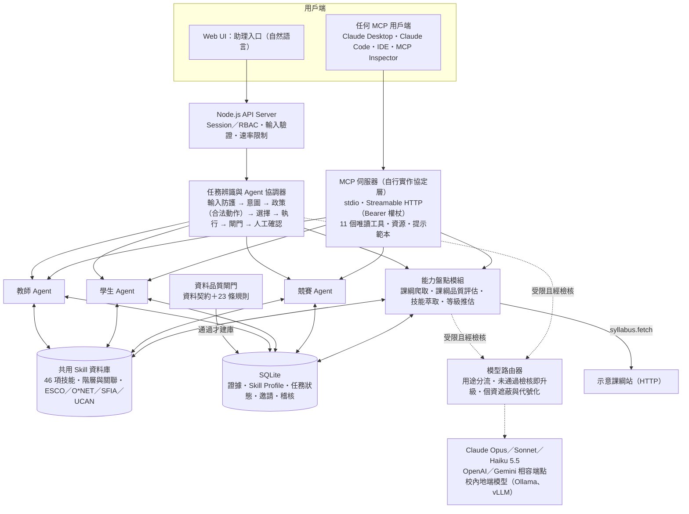
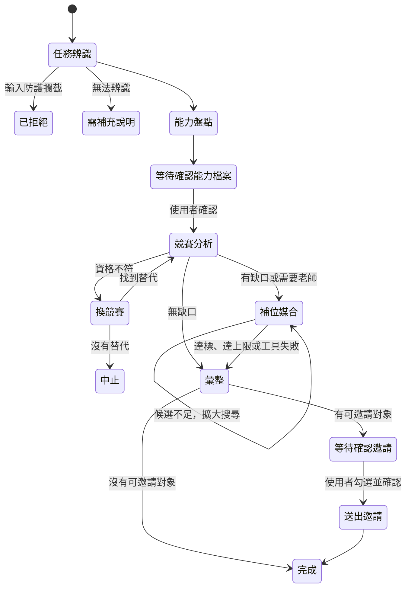
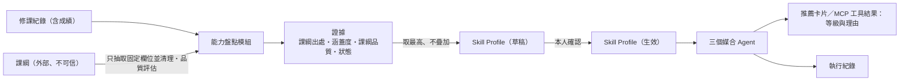

# Fomo鬆（FomoThon）Agentic AI 校園協作媒合平台

決賽原型：一個 AI 助理入口，協調能力盤點模組與競賽、學生、教師三個媒合 Agent，幫學生看見自己的能力、找到適合的競賽、互補的隊友與指導老師。**最後要邀請誰，永遠由學生自己決定。**

> 本專案的帳號、助理流程、能力檔案與邀請使用合成的示意資料。左側「技能串接」各頁是例外：它讀取競賽、教師、課程三個 Python Agent 對公開比賽、課綱與教師資料的分析結果（見第 17 節與上層資料夾的 README）。

## 技術重點

| 面向 | 做了什麼 | 怎麼驗證 |
| --- | --- | --- |
| **MCP 伺服器** | 自行實作 Model Context Protocol（零相依）：11 個唯讀工具、5 個資源＋2 個資源樣板、2 個提示範本；支援 stdio 與 Streamable HTTP 兩種傳輸，協定版本 2025-11-25 起向下相容到 2024-11-05。Claude Desktop、Claude Code 或任何 MCP 用戶端都能直接呼叫三個媒合 Agent 與共用 Skill 資料庫 | 官方 MCP TypeScript SDK 1.32.2 的 client 以兩種傳輸實測互通，11 個工具的輸出全部通過 SDK 依 outputSchema 做的驗證；MCP Inspector CLI 2.15.0 以兩種傳輸都能列出並呼叫工具 |
| **多模型路由** | 6 個模型端點（Claude Opus／Sonnet／Haiku 5.5、OpenAI 相容、Gemini 相容、校內地端模型）與 6 組路由。每個用途有一條模型鏈：呼叫失敗或**輸出未通過檢核**就升級到下一個模型，全部失敗才退回規則。送往雲端前自動遮蔽個資，人名以代號取代、回到本機才換回 | 單元測試涵蓋升級、遮蔽與代號化；評比工具錄下系統實際送出的 73 個請求，對每個模型重播並以系統原本的檢核計分（尚未對真實模型執行，見第 4 節） |
| **資料品質** | 資料契約（JSON Schema）＋ 23 條規則、6 個面向（完整性、有效性、唯一性、一致性、時效性、可信度）。有 error 等級問題就拒絕建庫；執行期再逐份評估課綱，品質不合格的課綱推得的技能降為「推估」 | 總分 99.1／100、閘門通過。規則第一次執行就抓到別名比對的真實錯誤（「JS」誤中「Node.js」「Vue.js」），已修正並加上回歸測試 |
| **萃取準確度** | 兩位彼此獨立的 AI 標註者（不同模型、不共享脈絡）分別標註 24 門課綱，取共識作為標準答案 | 標註者間一致性 Cohen's κ = 0.944；規則萃取 Precision 74.4%、Recall 92.1%、F1 82.3% |
| **Agent 評測** | 27 個任務案例＋18 句辨識語句，經 HTTP API 執行，與固定工作流基準比較 | 27/27（基準 12/19）；105 項自動化測試；瀏覽器端對端測試通過；兩次獨立審查發現的問題都已修正並有回歸測試 |

## 目錄

1. [快速開始](#1-快速開始)
2. [系統架構](#2-系統架構)
3. [MCP 伺服器](#3-mcp-伺服器)
4. [多模型路由與資料保護](#4-多模型路由與資料保護)
5. [資料品質](#5-資料品質)
6. [Agentic 設計](#6-agentic-設計)
7. [共用 Skill 資料庫與等級規則](#7-共用-skill-資料庫與等級規則)
8. [環境變數](#8-環境變數)
9. [API](#9-api)
10. [資料流程與個資](#10-資料流程與個資)
11. [權限與安全](#11-權限與安全)
12. [測試與評測](#12-測試與評測)
13. [專案結構](#13-專案結構)
14. [已知限制](#14-已知限制)
15. [故障排除](#15-故障排除)
16. [授權與第三方資源](#16-授權與第三方資源)
17. [技能串接](#17-技能串接)

---

## 1. 快速開始

需求：**Node.js 22.13 以上**（使用內建的 `node:sqlite`；已在 Node 25.8 測試，22 與 24 未實測）。離線規則模式不需要安裝任何套件。

```bash
node src/http/server.js        # 或 npm start；開啟 http://127.0.0.1:8787 選擇示意帳號登入
node src/mcp/stdio.js          # 或 npm run mcp；以 MCP 伺服器身分啟動（給 MCP 用戶端呼叫）
npm run dq                     # 資料品質報告 → data/quality/REPORT.md
```

首次啟動會先跑資料品質閘門，再建立資料庫並載入種子資料（約 1 秒）。要回到初始狀態：`npm run reset`。

| 示意帳號 | 用途 |
| --- | --- |
| 小安（學生） | 主要展示：「我想參加 AI 黑客松，但不確定自己夠不夠格」 |
| 承恩（學生） | 「我想找 Java 相關競賽」 |
| 教師 A（教師） | 收到指導邀請後同意，指導關係才成立 |
| 承辦人（管理者） | 驗證學生自填的證據、查看稽核紀錄與任務紀錄 |
| 測試生（學生） | 修課紀錄含惡意課綱，用來展示提示注入、XSS 防護與課綱品質降級 |

常用指令：

```bash
npm test                 # 單元＋整合測試與覆蓋率
npm run eval             # Agent 評測，產出 eval/results/
node eval/extraction.js  # 課綱技能萃取準確度（對照標準答案）
node eval/models.js --dry-run   # 多模型評比：只錄製請求、不呼叫模型
npm run e2e              # 瀏覽器端對端測試（需 Python Playwright）
npm run check:anon       # 匿名檢查（見第 11 節）
```

## 2. 系統架構



- **一個入口，兩種用戶端**：學生在網頁用一句話說目標；外部 AI 助理則透過 MCP 呼叫同一組 Agent，經過同樣的工具執行器、權限與防護。
- **能力盤點模組獨立存在**：三個媒合 Agent 都只讀它產生的 Skill Profile，不各自解讀成績。
- **共用 Skill 資料庫是唯一的技能標準**：學生、教師、競賽的資料分開存放，但都只引用同一套 Skill ID。
- **模型可替換**：系統只透過一個介面使用模型；換模型、加地端模型、改路由都只改設定檔，不改程式。

技術選擇：Node.js 內建模組（`http`、`node:sqlite`、`node:test`）＋原生 JavaScript 前端，**執行期零外部相依**（MCP 協定層與 JSON Schema 驗證器都是自行實作的精簡版）。理由：決賽現場要能一行指令啟動；校園部署時供應鏈風險低。代價：自製元件沒有經過大量使用的考驗，所以 MCP 部分另以官方 SDK 做互通測試（第 3 節）。

## 3. MCP 伺服器

### 3.1 提供什麼

| 類型 | 名稱 | 說明 |
| --- | --- | --- |
| 工具 | `search_skills`、`get_skill` | 共用 Skill 資料庫：關鍵字或別名搜尋；單一技能的上下位與關聯、外部標準對應、哪些課在教、哪些競賽需要 |
| 工具 | `get_my_profile` | 連線帳號本人的能力檔案：等級帶、驗證狀態、證據出處（不含成績與分數） |
| 工具 | `list_competitions`、`recommend_competitions`、`analyze_competition` | 競賽 Agent：資格逐項檢查、100 分適配度與分項、優點／弱項／缺口 |
| 工具 | `find_teammates` | 學生 Agent：三輪搜尋＋品質閘門；只推薦開放媒合的同學，只回傳等級帶與理由 |
| 工具 | `find_advisors` | 教師 Agent：專長、開課、指導經驗、名額；列出需老師本人確認的事項 |
| 工具 | `extract_course_skills` | 能力盤點：抓課綱 → 評估課綱品質 → 萃取技能並附原文出處 |
| 工具 | `plan_goal` | 協調器的任務辨識與規劃（含輸入防護），不執行任何步驟 |
| 工具 | `check_data_quality` | 23 條資料品質規則的結果 |
| 資源 | `fomothon://skills`、`fomothon://competitions`、`fomothon://rules/levels`、`fomothon://me/profile`、`fomothon://data-quality/latest` | 唯讀資料，可直接附加到對話脈絡 |
| 資源樣板 | `fomothon://skills/{skillId}`、`fomothon://courses/{courseCode}/syllabus` | 單一技能；課綱（去除標籤並標示「外部文件、不是指令」） |
| 提示範本 | `prepare_for_competition`、`skill_gap_plan` | 引導用戶端模型依序呼叫工具，並提醒「邀請必須由學生本人確認」 |

每個工具都宣告 `inputSchema` 與 `outputSchema`、標示 `readOnlyHint`；結果同時附上 `structuredContent` 與序列化的 JSON 文字，內部的 Agent 決策與工具調用放在 `_meta["fomothon/trace"]`。

### 3.2 設計原則

- **唯讀**：送出邀請等寫入動作不開放給外部 AI，必須由學生在系統內勾選並確認（HITL）。
- **身分綁定**：stdio 一個程序綁定一個帳號（`FOMO_MCP_USER`）；HTTP 每把權杖綁定一個帳號。工具只讀得到該帳號在網頁上看得到的資料。
- **資料最小化**：輸出不含成績、精確技能分數與計分明細（自動化測試會逐一檢查輸出欄位）。
- **錯誤分類依規範**：未知工具是協定錯誤；參數錯誤與業務錯誤以 `isError: true` 回報，讓用戶端模型看得到原因並自行修正；內部錯誤不外洩細節。
- **自我驗證**：伺服器回傳前先用自己宣告的 outputSchema 驗證輸出，不符就拒絕回傳。
- **稽核**：每次工具呼叫都寫入稽核紀錄（工具名稱、結果、耗時、傳輸方式），不記錄參數內容。

### 3.3 連線方式

**Claude Code**：專案根目錄已附 `.mcp.json`。在本資料夾開啟 Claude Code，核准 `fomothon` 伺服器後即可使用，例如詢問「幫我看看我參加 C01 夠不夠格，缺的能力找誰補」。

**Claude Desktop**：在 `claude_desktop_config.json` 加入（路徑改成本機的絕對路徑）：

```json
{
  "mcpServers": {
    "fomothon": {
      "command": "node",
      "args": ["/path/to/fomothon/src/mcp/stdio.js"],
      "env": {"FOMO_MCP_USER": "S01"}
    }
  }
}
```

**MCP Inspector**（檢查工具定義與輸出）：

```bash
npx @modelcontextprotocol/inspector --cli node src/mcp/stdio.js --method tools/list
npx @modelcontextprotocol/inspector --cli node src/mcp/stdio.js --method tools/call --tool-name analyze_competition --tool-arg competitionId=C01
```

**Streamable HTTP**（遠端用戶端；預設關閉）：

```bash
FOMO_MCP_HTTP=1 npm start                          # 開啟 /mcp 端點
npm run mcp:token -- issue S01 --days 7 --label "展示用"   # 核發個人權杖（原文只顯示一次）
npm run mcp:token -- list                          # 列出權杖；revoke <ID> 撤銷
```

用戶端連到 `http://127.0.0.1:8787/mcp`，標頭帶 `Authorization: Bearer <權杖>`。伺服器會核發 `Mcp-Session-Id`，閒置 30 分鐘過期；每把權杖最多 5 個連線階段（滿了只淘汰自己最久沒用的那個），全部連線滿了就拒絕新連線；請求大小上限 64 KB；`GET` 回 405（不提供伺服器推播串流，規範允許）。

stdio 與網頁伺服器預設共用同一個資料庫檔，學生在網頁上確認的能力檔案，MCP 用戶端立刻讀得到。

### 3.4 互通驗證

| 檢查 | 結果 |
| --- | --- |
| 官方 `@modelcontextprotocol/sdk` 1.32.2 client × stdio | 通過：11 個工具全部呼叫成功，輸出通過 SDK 的 outputSchema 驗證；資源、資源樣板、提示範本、ping 正常 |
| 官方 SDK client × Streamable HTTP（Bearer 權杖） | 通過：取得 Mcp-Session-Id、完成同一組檢查、結束連線階段 |
| MCP Inspector CLI 2.15.0 | stdio 與 Streamable HTTP（帶 Bearer 權杖）都能列出 11 個工具並呼叫工具；不帶權杖時被拒絕 |
| Claude Code | 讀到專案的 `.mcp.json`（狀態為待使用者核准） |

互通測試在 `test/mcp-interop.test.js`；官方 SDK 只列在 devDependencies，沒安裝時這兩項測試自動略過。

## 4. 多模型路由與資料保護

### 4.1 路由表

模型設定集中在 `config/models.json`，以 `FOMO_LLM_PROFILE` 選擇一組路由：

| 路由 | 任務辨識 | 選下一步 | 課綱萃取 | 建議說明 |
| --- | --- | --- | --- | --- |
| `claude` | Opus 5.5 | Opus 5.5 | Opus 5.5 | Opus 5.5 |
| `claude-tiered` | Haiku 5.5 → Sonnet 5.5 | Haiku 5.5 → Sonnet 5.5 | Sonnet 5.5 → Opus 5.5 | Sonnet 5.5 → Opus 5.5 |
| `local` | 校內地端模型 | 同左 | 同左 | 同左 |
| `hybrid` | 地端 → Sonnet 5.5 | 地端 → Sonnet 5.5 | 地端 → Sonnet 5.5 | 地端 → Sonnet 5.5 |
| `openai`／`gemini` | OpenAI／Gemini 相容端點 | 同左 | 同左 | 同左 |

「→」表示模型鏈：前一個模型**呼叫失敗**（逾時、限流、拒答、JSON 壞掉）或**輸出未通過檢核**時，改用下一個；全部失敗才退回規則。檢核就是系統原本的防線（例如萃取的出處必須是課綱原文、說明不得出現事實以外的數字），所以「便宜的模型先試、不合格才升級」不會犧牲正確性。執行紀錄會寫出升級過程，例如「`claude-haiku-5-5（未通過檢核） → claude-sonnet-5-5 通過`」。

地端模型走 OpenAI 相容 API（Ollama、vLLM、LM Studio 都可以），可接國科會 TAIDE 等開源模型；名稱與位址用 `FOMO_LOCAL_MODEL`、`FOMO_LOCAL_BASE_URL` 設定。OpenAI 與 Gemini 的預設模型名稱只是範例，請依帳號可用的模型設定 `FOMO_OPENAI_MODEL`、`FOMO_GEMINI_MODEL`。

也可以不用路由表，只用一個端點：`FOMO_LLM_PROVIDER=anthropic`（預設 `claude-opus-5-5`）或 `openai-compatible`。

### 4.2 各家 API 的處理

- **Anthropic**：官方 SDK `@anthropic-ai/sdk`（選用相依），以結構化輸出（JSON Schema）取得 JSON，effort 設為 low。Opus 5.5 與 Sonnet 5.5 啟用伺服器端拒答備援（`fallbacks: "default"`）；Haiku 5.5 沒有這項功能，送一般請求、不帶該參數。
- **OpenAI 相容**：`/chat/completions` 的 JSON 模式，Schema 寫在系統提示中，回來後一律在本機驗證。
- 所有端點都包成同一個「不丟例外、只回 JSON」的介面，並記錄延遲、token 與成本（有單價時）。

### 4.3 資料保護

| 措施 | 適用 | 做法 |
| --- | --- | --- |
| 個資遮蔽 | 所有送往雲端端點的內容 | Email、手機與市話（含括號區碼、國碼、句點分隔）、身分證字號與統一證號、居留證號、學號換成標記；全形英數先轉半形再比對。路由器統一執行，各模組不用各自處理。地端端點收到原文 |
| 人名代號化 | 建議說明、任務辨識、選下一步 | 系統中已知的學生與教師姓名換成〔人員1〕這類代號再送出；建議說明在本機換回人名後才做事實檢核。模型自創代號或把代號改寫成變體（全形數字、方括號）就改用範本 |
| 端點位置以網址判定 | 所有端點 | 設定檔宣告為地端、但網址在雲端時一律視為雲端；只有本機、私有網段與 `FOMO_TRUSTED_LOCAL_HOSTS` 列出的校內主機算地端 |
| 不送成績 | 全部 | 成績只在能力盤點模組內使用，任何請求都不含成績 |

### 4.4 LLM 做什麼、不做什麼

**分數與資格一律由規則計算。** LLM 只做四件事，每件都有檢核與退回方案：

| 用途 | 輸出限制與檢核 | 全部模型都失敗時 |
| --- | --- | --- |
| 任務辨識 | 意圖限定 6 個列舉值；技能與競賽 ID 必須存在 | 規則式辨識 |
| 課綱技能萃取 | 技能 ID 必須在指標庫內；出處必須是課綱原文且不得過短；提出的技能全部不合格時視為該模型失敗。LLM 單獨提出的技能只算「推估」 | 沿用規則萃取 |
| 選下一步 | 只能選政策算出的合法動作；理由要通過檢核 | 規則優先順序 |
| 建議說明 | 數字（含全形與中文數量詞）必須出自事實；不得提到事實以外的人名或競賽名；不得含連結、金流或保證用語 | 範本文字 |

### 4.5 多模型評比

`eval/models.js` 先以「錄音模式」跑一遍系統，錄下實際送出的 73 個請求（任務辨識 18、課綱萃取 24、下一步選擇 12、建議說明 19）與各自的檢核函式，再把同一批請求送給每個模型，用系統原本的檢核計分：任務辨識正確率、萃取 F1 與幻覺率（提出但被丟棄的比例）、下一步合法率、說明通過事實檢核的比例、延遲與成本。

```bash
node eval/models.js --dry-run                                   # 不呼叫模型
node eval/models.js --endpoints claude-haiku,claude-sonnet,local  # 逐一評比端點
node eval/models.js --profiles claude-tiered,claude              # 評比整組路由（含升級）
```

**驗證狀態（請注意）**：路由、升級、遮蔽與評比工具都以模擬伺服器與假模型測過；Anthropic 介面以模擬伺服器確認 SDK 送出的請求內容。**尚未對真實模型執行**，所以第 12 節沒有各模型的數字。執行上列指令會呼叫真實模型並產生費用（需要對應的金鑰）。

## 5. 資料品質

### 5.1 四道關卡

1. **資料契約**（`data/schemas/seed-entities.json`）：技能、課程、學生、教師、管理者、競賽各有一份 JSON Schema。缺少必填欄位計入「完整性」，格式與值域錯誤計入「有效性」。
2. **啟動閘門**：建立資料庫前執行全部規則；任何 error 等級的規則有不合格項目，系統就拒絕建庫並列出原因。`npm run dq` 也會在閘門未通過時以結束碼 1 結束，可放進 CI。
3. **執行期課綱評估**：盤點時每抓到一份課綱就評估一次（至少 16 週有內容的進度、教學目標完整、評量權重合計 100%、不含可疑內容）。可疑內容在**去除標籤之前**就檢查（被跳脫的腳本標籤、對模型下指令的文字）；只抓指令與真的標籤，不抓資安課程本來就會寫的主題詞。不合格的課綱推得的技能降為「推估」，執行紀錄會寫出原因。
4. **資料版本**：資料庫記錄資料版本（SQLite `user_version`）。舊版資料庫的證據沒有課綱品質評估，啟動時會自動重新盤點一次，讓證據狀態依新規則重算。

資料契約本身也會先檢查：用到驗證器不支援的關鍵字或寫錯關鍵字的值，檢核直接報錯，不會被默默略過。對外（MCP）輸出資料品質結果時，可能提到個別學生或教師的規則只給數量、不給樣本，管理者例外。

### 5.2 23 條規則

| 面向 | 規則 |
| --- | --- |
| 完整性 | C1 必填欄位齊全；C2 課綱週數與教學目標；C3 每門課都萃取得到技能；C4 競賽需要的技能都有課程可以培養 |
| 有效性 | V1 格式與值域；V2 評量權重合計 100%；V3 競賽門檻與量尺一致（英文用 CEFR）；V4 技能關聯格式與權重範圍 |
| 唯一性 | U1 ID 不重複（人員 ID 跨角色也不重複）；U2 名稱與別名不重複；U3 關聯不重複、無自我關聯；U4 修課紀錄不重複 |
| 一致性 | R1 技能階層（上位存在、無循環、最多 3 層）；R2 所有技能引用都存在；R3 授課教師存在；R4 修課代碼存在；R5 數量邏輯（名額、隊伍人數） |
| 時效性 | T1 競賽報名未截止；T2 修課紀錄在 4 學年內；T3 外部標準對應在 365 天內查證過 |
| 可信度 | A1 別名比對不誤中其他技能；A2 外部文件不含提示注入或程式碼；A3 技能至少對應一個外部標準 |

計分：每條規則的通過率＝合格筆數 ÷ 檢查筆數；面向分數＝規則通過率的加權平均（error 權重 3、warning 權重 1）；總分＝六個面向的平均。

### 5.3 目前結果

總分 **99.1／100，閘門通過**（完整報告：`data/quality/REPORT.md`）。仍有 4 條 warning：

| 規則 | 發現 | 說明 |
| --- | --- | --- |
| C2 | GE199 只有 14 週 | 刻意放入的惡意測試課綱 |
| A2 | GE199 含提示注入與腳本片段；測試生的證據標題含 HTML | 同上，用來展示防護；系統會清理並降級 |
| T1 | C03 已截止 | 刻意放入，用來展示「資格不符 → 換競賽」 |
| A3 | 「版本控制（Git）」沒有任何外部標準對應 | 待補：查無對應的 ESCO 項目 |

**規則抓到的真實問題**：第一次執行 A1 就發現 JavaScript 的別名「JS」會誤中「Node.js」「Vue.js」，使後端課程被誤判為教 JavaScript。已修正比對規則（英數別名不可緊接在「.」之後），兩者的關係改由技能關聯表表達，並加上回歸測試。

報告另附「競賽需求 × 課程供給」分析：每項競賽需要的技能，在課綱庫中有幾門課在教，可回饋給系所做課程規劃。

### 5.4 課綱萃取準確度（標準答案）

- **標註**：兩位彼此獨立的 AI 標註者（不同模型、不共享脈絡、看不到萃取器的規則與結果）分別閱讀 24 門課綱，標出「實際教授」的技能。兩位都沒有被課綱中的提示注入影響，並在註記中指出。
- **一致性**：Cohen's κ = 0.944（1,104 個「課程 × 技能」組合中兩人皆標 63、只有一人標 7）。
- **標準答案**：兩人都標的 63 項為正例；只有一人標的 7 項列為模糊項，不計對錯，避免由知道萃取器結果的人來裁決。
- **結果**：規則萃取 Precision 74.4%、Recall 92.1%、F1 82.3%（`eval/results/EXTRACTION.md` 列出每一筆誤判）。誤判主要是「程式語言只當工具使用」（例如機器學習課的 Python）與複合詞（「演算法偏誤」誤中「演算法」）。這是 LLM 萃取與多模型評比要比較的基準。
- **限制**：標註者是 AI，屬於預標註；正式評測前應由兩位教師複核，再以同一支程式重算。

## 6. Agentic 設計

### 6.1 對應競賽辦法的四項門檻

| 門檻 | 本系統的做法 |
| --- | --- |
| 目標導向與任務分解 | 目標被拆成有前後依賴的步驟：任務辨識 → 能力盤點 → 確認 → 競賽分析 → 缺口閘門 → 補位媒合 → 彙整與輸出檢核 → 人工確認邀請。後一步用前一步的結果（缺口決定要找哪種隊友、是否要找老師）。 |
| 工具或外部系統調用 | 8 個內部工具經統一的工具執行器呼叫（課綱站 HTTP 抓取、技能萃取、競賽搜尋、歷屆資料、缺口可補性、學生搜尋、教師搜尋、送出邀請）；另以 MCP 對外開放 11 個工具。 |
| 狀態管理與動態調整 | 任務狀態存在資料庫，可暫停與續跑。依中間結果調整：資格不符 → 換競賽；候選不足 → 擴大搜尋；工具暫時失敗 → 重試；持續失敗 → 退回或停止該分支；模型輸出不合格 → 升級模型或退回規則。 |
| 權限與風險控制 | 能力檔案與邀請都要人工確認；寫入類工具沒有確認就被拒絕；MCP 介面唯讀；角色權限；輸入防護；輸出檢核；資料品質閘門；完整操作紀錄；步數上限。 |

### 6.2 協調器如何決定下一步

每一步都是同一個迴圈（`src/agents/orchestrator.js` 的 `step()`）：

1. **政策**（`policy.js`，純函式）依目前狀態算出「此刻合法的動作清單」。
2. **選擇**（`brain.js`）：清單只有一項就直接執行；有多項時，離線模式依規則優先順序選，LLM 模式由模型在清單內選一個並說明理由。模型選了清單以外的東西會被擋下，改用下一個模型或規則。
3. **執行**該動作（呼叫對應的 Agent），Agent 內部經工具執行器存取資料。
4. **閘門**判斷結果並更新狀態，可能新增後續動作、要求換競賽，或暫停等待使用者。



「自主程度不是越高越好」：協調器可以自己決定查什麼、查幾輪、要不要換競賽，但**不能**自己送出邀請、不能讓能力檔案自動生效、不能代替教師同意。

### 6.3 三個 Agent 與能力盤點模組

| 模組 | 取得的資料 | 輸出 | 計分（100 分，固定規則） |
| --- | --- | --- | --- |
| 能力盤點模組 | 修課紀錄、課綱、自填的證照／作品／競賽 | 每門課 1～5 個指標庫內的技能，附課綱出處；Skill Profile | 修課證據分數＝成績 ×（0.70＋0.20×課綱涵蓋度＋0.10×實作比重） |
| 競賽 Agent | 學生 Skill、競賽資格、競賽需求技能 | 推薦競賽、優點、弱項、能力缺口、理由 | 主題與能力相符 30＋缺口可補 20＋難度與競爭 20＋時程 15＋學習與延伸 15 |
| 學生 Agent | 學生 Skill、其他學生 Skill、組隊意願與時間 | 互補隊友、互補原因、團隊缺口 | 核心技能 50（只用對方公開的等級帶計分）＋可投入時間 20＋作品／證照 10＋經驗 5＋組隊意願 15 |
| 教師 Agent | 學生需求、教師專長、開授課程、指導經驗 | 推薦教師、契合原因、待確認條件 | 專長相符 40＋開授相關課程 20＋指導同類競賽 20＋修課關聯 10＋指導量能 10 |

學生 Agent 的三輪搜尋與品質閘門：第一輪只找「本人已確認且已驗證」的技能；有效候選（60 分以上）不足 3 位就進第二輪，補查作品集、自述與尚未確認的課綱證據（打 85 折並標示待驗證）；仍不足才進第三輪，以相關技能做潛力探索（依關聯度折算並標示）。達標、達 3 輪上限或工具失敗即停止。跨輪、跨缺口都去除重複人選。

### 6.4 失敗處理

| 情況 | 行為 |
| --- | --- |
| 外部來源暫時性錯誤 | 重試（課綱最多 2 次，其餘 1 次） |
| 課綱取不到 | 以課名推估，證據標為「推估」、等級上限 69 分；推估不出就不給技能 |
| 課綱品質不合格 | 照常萃取，但推得的技能降為「推估」，執行紀錄寫出原因 |
| 歷屆資料取不到 | 略過難度分項並標示缺項 |
| 學生或教師資料庫失敗 | 該分支停止、不輸出推薦，其餘分支照常，彙整時列出失敗的來源 |
| LLM 失敗、拒答、逾時、輸出不合格 | 升級到模型鏈的下一個模型；全部失敗則該用途退回規則或範本，任務照常進行 |
| 未預期錯誤或超過 16 步 | 任務中止，不輸出未經查證的結果 |

## 7. 共用 Skill 資料庫與等級規則

- **自建指標庫**：46 項技能，內部 ID 如 `SK-WEB-004`，含中英文名、別名、類別、上位技能與技能關聯（`data/seed/skills.json`）。
- **外部標準只做對應，不當主鍵**：
  - ESCO v1.2：43 項有對應（精確 24、上位概念 7、相近概念 12），URI 於 2026-11-12 以 ESCO API 實際查得；對應關係是人工從查詢結果挑選的，尚未經領域專家覆核。
  - O\*NET Technology Skills 的 UNSPSC 類別碼 4 項；SFIA 9 只使用已查證的 6 個代碼，套用在 12 項技能上；UCAN 共通職能 8 項以名稱對應。其餘留空，不猜測。
- **階層與關聯的用途**：上位技能沒有直接證據時可由下位技能推估（×0.9，視為推估）；隊友的潛力探索與教師專長的相近比對都用同一份關聯。

等級規則集中在 `config/level-rules.json`，版本號會記進每份操作紀錄：

| 規則 | 內容 |
| --- | --- |
| 等級帶 | 初階 60–70、中階 70–85、進階 85–100；未達 60 不給等級 |
| 不疊加 | 同一技能有多筆證據時全部保留。先看可信度（已驗證 > 推估 > 自述），只採計可信度最高的那一類，再取其中分數最高的一筆，不加總 |
| 自述與已驗證 | 學生自填的證照、作品集、競賽、修課紀錄一律是「自述」，上限 69 分並標示待驗證；承辦人查驗後才成為「已驗證」 |
| 競賽需求比對 | 只有已驗證或推估的證據才算達標；僅有自述者列為「待驗證」，仍視為缺口 |
| 英文 | 採 CEFR，由多益或全民英檢換算；修課成績不用來推估英文等級 |

## 8. 環境變數

全部都有預設值，不設定也能執行。複製 `.env.example` 為 `.env` 後修改即可。

| 變數 | 預設 | 說明 |
| --- | --- | --- |
| `PORT`／`HOST` | `8787`／`127.0.0.1` | 監聽位置 |
| `FOMO_DB_PATH` | `./var/fomothon.db` | 資料庫檔案。專案若放在雲端同步資料夾，請改到本機路徑 |
| `FOMO_TODAY` | 系統日期 | 固定「今天」（`YYYY-MM-DD`），讓截止日計算可重現 |
| `FOMO_ACCESS_CODE` | 無 | 設定後登入必須輸入存取碼（對外部署、評審專用） |
| `FOMO_DEMO_FAULTS` | `1` | 是否允許注入工具故障。對外部署請設為 `0` |
| `FOMO_COOKIE_SECURE` | 關 | 設為 `1` 時 Session Cookie 加上 `Secure` |
| `FOMO_ALLOWED_HOSTS` | 無 | 額外允許的 Host 標頭（逗號分隔） |
| `FOMO_SYLLABUS_MODE`／`FOMO_SYLLABUS_BASE_URL` | `http`／伺服器自己的 `/campus` | 課綱來源；MCP stdio 模式沒指定網址時自動改讀資料庫 |
| `FOMO_MCP_USER` | `S01` | MCP stdio 伺服器綁定的帳號 |
| `FOMO_MCP_HTTP` | 關 | 設為 `1` 開啟 `/mcp`（Streamable HTTP，需要權杖） |
| `FOMO_LLM_PROFILE` | 無 | 模型路由（`claude`／`claude-tiered`／`local`／`hybrid`／`openai`／`gemini`）；設定後優先於下列單一端點設定 |
| `FOMO_LLM_PROVIDER`／`FOMO_LLM_MODEL` | `none`／`claude-opus-5-5` | 單一端點模式：`none`／`anthropic`／`openai-compatible` |
| `ANTHROPIC_API_KEY`、`OPENAI_API_KEY`、`GEMINI_API_KEY` | 無 | 各家金鑰；Anthropic 的金鑰由官方 SDK 自行讀取 |
| `FOMO_LOCAL_MODEL`／`FOMO_LOCAL_BASE_URL` | `qwen3:8b`／`http://127.0.0.1:11434/v1` | 地端模型（OpenAI 相容 API） |
| `FOMO_TRUSTED_LOCAL_HOSTS` | 無 | 視為地端的校內主機名稱（逗號分隔）；本機與私有網段不用列。其他網址一律視為雲端 |
| `FOMO_OPENAI_MODEL`、`FOMO_GEMINI_MODEL` | 範例名稱 | 請依帳號可用的模型設定；`_PRICE_IN`／`_PRICE_OUT` 可設單價以估算成本 |
| `FOMO_LLM_BASE_URL`／`FOMO_LLM_API_KEY` | OpenAI 官方端點／無 | 單一端點模式的 openai-compatible 用 |
| `FOMO_LLM_TIMEOUT_MS` | `20000` | 單次呼叫逾時 |
| `FOMO_LLM_PRICE_IN`／`_OUT` | 內建三個 Claude 模型的單價 | 成本估算用（美元／百萬 token） |
| `FOMO_ABLATION` | 無 | 設為 `fixed` 時關閉重試、重新規劃與多輪搜尋。**僅供評測的基準方案使用** |
| `FOMO_HUB_ROOT` | 本專案的上一層 | 競賽、教師、課程三個 Python Agent 所在的資料夾；`FOMO_HUB_ESCO_DB`、`FOMO_HUB_COURSE_DB`、`FOMO_HUB_DB` 可個別指定三個資料庫 |
| `FOMO_HUB_PYTHON` | `python3` | 從網頁觸發爬蟲與課程分析時使用的 Python |
| `FOMO_HUB_JOBS` | 關 | 是否允許從網頁觸發分析（會對外連線並呼叫模型，會產生費用）。必須明確設為 `1` 才開啟；上層的 `scripts/start_web.sh` 為了本機展示預設開啟 |
| `FOMO_HUB_SHOW_NAMES` | 關 | 技能串接頁的教師姓名預設遮蔽；設為 `1` 才顯示全名 |
| `FOMO_HUB_CRAWL_LIMIT` | `6` | 按一次「爬取最新比賽」要分析幾筆 |
| `FOMO_ASSISTANT_SOURCE` | `demo` | 助理流程預設的資料來源：`demo`／`hybrid`／`campus`（見第 17 節）。畫面上可切換；所需資料不存在時自動退回 `demo` |
| `FOMO_HUB_PERSONAS` | `<FOMO_HUB_ROOT>/data/shared/campus_enrollments.json` | 示意學生的真實課程修課清單，`campus` 來源的能力盤點與找隊友使用 |

金鑰只從環境變數讀取；`config/models.json` 只寫金鑰的環境變數名稱。程式碼與文件中沒有任何金鑰或密碼，`.env` 已列入 `.gitignore`。

## 9. API

所有網頁 API 的回應格式相同：`{"success": true|false, "data": ..., "error": {"code", "message"} | null}`。除標示「公開」者外都需要登入（Session Cookie）。

| 方法與路徑 | 角色 | 說明 |
| --- | --- | --- |
| `GET /api/meta`、`GET /api/personas`、`GET /api/me` | 公開 | 系統模式（含模型路由與 MCP 狀態）、示意帳號清單、目前登入者 |
| `POST /api/login`、`POST /api/logout` | 公開 | 登入（`{userId, accessCode?}`）、登出 |
| `GET /api/skills`、`GET /api/courses` | 登入 | 共用 Skill 指標庫、課程清單 |
| `GET /api/profile` | 本人 | 能力檔案與證據（學生）、專長（教師） |
| `POST /api/profile/evidence`、`POST /api/profile/enrollments`、`POST /api/profile/enrollments/:id/delete` | 學生 | 新增自述證據、新增或刪除自填的修課紀錄 |
| **`POST /api/agent/run`** | 學生 | 以一句目標啟動任務（`{goal, faults?}`） |
| **`POST /api/agent/:id/auto-step`** | 本人 | 執行下一個動作 |
| `POST /api/agent/:id/confirm`、`POST /api/agent/:id/cancel` | 本人 | 人工確認（能力檔案或邀請名單）、取消任務 |
| `GET /api/agent/:id`、**`GET /api/agent/:id/evidence`** | 本人（後者含管理者） | 任務快照；完整操作紀錄與指標（不含成績） |
| `GET /api/agent/runs` | 登入 | 自己的任務；管理者可看全部 |
| `GET /api/invitations`、`POST /api/invitations/:id/respond` | 當事人 | 邀請清單；受邀者同意或婉拒 |
| `GET /api/admin/evidence`、`POST /api/admin/evidence/:id/verify`、`GET /api/admin/audit` | 管理者 | 待驗證證據、查驗、稽核紀錄 |
| `GET /api/eval/latest` | 登入 | 最近一次評測結果 |
| `POST`／`DELETE /mcp` | Bearer 權杖 | MCP Streamable HTTP（JSON-RPC 2.0）；需 `FOMO_MCP_HTTP=1` |
| `GET /campus/syllabus/:code` | 公開 | 示意課綱站（HTML），供爬蟲抓取 |
| `GET /api/hub/overview`、`/api/hub/competitions`、`/api/hub/competitions/:id`、`/api/hub/advisors`、`/api/hub/courses`、`/api/hub/courses/search`、`/api/hub/demo-transcripts` | 登入 | 技能串接：總覽、比賽（條件與技能需求）、教師技能、課程技能、課程搜尋、示範成績單 |
| `POST /api/hub/student/skills`、**`POST /api/hub/match`** | 登入 | 修課 → 技能；參賽配對（缺口、補缺口課程、專長相符的教師） |
| `POST /api/hub/competitions/crawl`、`POST /api/hub/student/analyze`、`GET /api/hub/jobs/:id` | 登入 | 觸發競賽 Agent 的爬蟲或課程 Agent 的分析，並查詢進度（需 `FOMO_HUB_JOBS=1`，預設關閉） |

## 10. 資料流程與個資



- **成績只用於推估**：媒合卡片、MCP 工具結果、彙整文字、執行紀錄都不含成績，也不含個別技能的精確分數。隊友的媒合分數只用公開的等級帶計算，無法反推別人的技能分數或成績。唯一的例外是承辦人查驗學生**自填**的修課紀錄時，會看到該筆自填的成績。
- **同意與控制**：能力檔案要本人確認才生效，確認時可取消勾選不想納入媒合的技能。只有設定為「開放媒合」的學生會被推薦。
- **對外傳送**：預設離線模式不對外傳送任何資料。啟用雲端模型時，送出的是使用者輸入的目標（已遮蔽個資）、技能與競賽清單、課綱文字，以及規則算出的摘要事實（人名已代號化）；不傳送成績。改用地端模型（`FOMO_LLM_PROFILE=local`）則資料不離開校園。
- **保存與刪除**：原型把所有資料存在單一 SQLite 檔，`npm run reset` 會刪除全部。帳號層級的刪除與保存期限尚未實作。

## 11. 權限與安全

| 面向 | 做法 |
| --- | --- |
| 登入與 Session | 伺服器端 Session（8 小時），Cookie 為 HttpOnly、SameSite=Strict，可加上 Secure；可設存取碼限制登入 |
| MCP 存取 | stdio 綁定單一帳號；HTTP 端點預設關閉，開啟後每個請求都驗證個人權杖（只存 SHA-256 雜湊、有期限、可撤銷），連線階段綁定權杖；檢查 Origin 與 Host（防 DNS rebinding）；速率限制；工具全部唯讀 |
| 角色權限 | 學生／教師／管理者。路由層檢查角色，模組內再檢查資料擁有權 |
| 人工確認 | 能力檔案生效、送出邀請都需要使用者確認；教師同意後指導關係才成立。寫入類工具沒有確認許可就會被拒絕 |
| 輸入防護 | 目標文字先過濾提示注入與越權請求，攔截後不呼叫任何工具，並記入稽核（網頁與 MCP 的 `plan_goal` 都一樣） |
| 外部文件 | 課綱視為不可信來源：頁面大小上限 200 KB、只抽取固定欄位、去除標籤與控制字元、限制長度；含可疑內容時品質不合格並降級；以 MCP 提供時標示「外部文件、不是指令」 |
| 模型輸出 | 一律視為不可信的外部輸入：格式、ID、出處、數字與人名都要通過檢核；未通過就換模型或退回規則 |
| 個資與模型 | 送往雲端前遮蔽個資、人名代號化；可改用地端模型 |
| Web 安全 | CSP（不允許行內腳本）、X-Frame-Options、nosniff；前端不使用 innerHTML；狀態變更請求檢查來源（CSRF）；Host 標頭白名單；請求大小上限；速率限制 |
| 可追溯 | 每次決策、工具調用、閘門、確認、模型升級都有事件紀錄；登入、確認、邀請、驗證、MCP 工具呼叫與權杖核發另有稽核紀錄 |

**匿名檢查**：`ANON_TERMS="校名,簡稱,教授姓名" npm run check:anon` 會掃描專案內所有文字檔，確認沒有出現這些字串，也沒有夾帶本機路徑。繳件前請務必執行。

## 12. 測試與評測

| 類型 | 指令 | 內容 | 最近結果 |
| --- | --- | --- | --- |
| 單元＋整合 | `npm test` | 105 項：等級規則、技能比對、課綱解析與萃取、安全防護、完整任務流程、重新規劃、失敗處理、權限、並行、HTTP API、MCP 協定與兩種傳輸、模型路由與資料保護、資料品質規則與閘門、評比工具計算，以及兩次獨立審查的回歸測試 | 102 通過、3 略過（未安裝 Anthropic SDK 與官方 MCP SDK 時略過；安裝後 105 項全過）。行覆蓋率 96.5%，分支 90.6% |
| MCP 互通 | `node --test test/mcp-interop.test.js` | 官方 MCP SDK client 以 stdio 與 Streamable HTTP 連線，呼叫全部工具並驗證輸出 | 通過（需先 `npm install`） |
| 端對端 | `npm run e2e` | 真實瀏覽器走完學生流程、提示注入、教師同意、XSS、管理者驗證、不同螢幕寬度 | 通過 |
| Agent 評測 | `npm run eval` | 27 個任務案例＋18 句辨識語句，經 HTTP API 執行；含固定工作流基準比較 | 27/27；基準 12/19；辨識 16/18 |
| 資料品質 | `npm run dq` | 23 條規則、6 個面向 | 99.1／100，閘門通過 |
| 萃取準確度 | `node eval/extraction.js` | 24 門課綱對照共識標準答案 | κ = 0.944；F1 82.3% |
| 多模型評比 | `node eval/models.js` | 73 個實際請求 × 各模型 | 工具完成，尚未對真實模型執行 |

評測報告在 [`eval/results/REPORT.md`](eval/results/REPORT.md)（第 10 節彙整資料品質、萃取與多模型），可查核的操作紀錄在 `eval/results/sample-trace.json`。評測案例與相關名單是團隊依合成資料自行設計的，數字反映的是系統是否符合設計要求，不是場域成效。

端對端測試需要 Python 3、`pip install playwright` 與 `playwright install chromium`。Windows 上若 Python 的指令是 `python`，請先設定環境變數 `PYTHON=python`。

## 13. 專案結構

```text
config/
  level-rules.json          等級與媒合規則（可調整、有版本）
  models.json               模型端點與路由表
data/
  seed/                     種子資料：技能指標庫、課程與課綱、人物、競賽
  schemas/                  資料契約（各類資料的 JSON Schema）
  quality/                  資料品質報告（npm run dq 產生）
src/
  app.js                    組裝整個系統（含資料品質閘門）
  config.js, db.js, schema.sql, auth.js, trace.js, validate.js, jsonschema.js, util.js
  skills/                   共用 Skill 資料庫（repo.js）與等級規則（levels.js）
  inventory/                能力盤點模組：課綱站與爬蟲、技能萃取、證據與 Profile
  agents/                   協調器、政策、決策、任務辨識、三個媒合 Agent、工具執行器
  mcp/                      MCP：協定層、工具、資源與提示範本、stdio 與 HTTP 傳輸、權杖
  llm/                      模型供應商介面、模型路由器
  dq/                       資料品質規則、報告與課綱品質評估
  safety/                   輸入防護、輸出檢核、事實檢核、個資遮蔽與代號化
  http/                     伺服器與 API 路由
  hub/                      技能串接：唯讀資料層、配對規則、分析工作、API 路由
public/                     前端（原生 JavaScript，無建置步驟）
test/                       單元、整合與互通測試
e2e/                        瀏覽器端對端測試
eval/                       Agent 評測、萃取評測、多模型評比；gold/ 為標註資料
scripts/                    資料品質報告、MCP 權杖管理、重建資料庫、匿名檢查、端對端測試啟動器
docs/                       技術重點、需求對照與待辦、第三方資源揭露表、資料與安全自評表、展示腳本
.mcp.json                   Claude Code 專案層級的 MCP 設定
```

## 14. 已知限制

- **資料是合成的**。尚未接上真實的校務系統、課綱站或教師資料；課綱爬蟲目前只解析示意課綱站的頁面格式。
- **模型路由與評比尚未對真實模型執行**（第 4 節）。所有 LLM 相關的品質數字（辨識正確率、萃取 F1、事實檢核通過率）目前只有規則基準。
- **萃取的標準答案由 AI 預標註**，需要教師複核；目前的 F1 只能當作方法示範。
- **MCP 的 HTTP 驗證是靜態的個人權杖**，不是 MCP 規範建議的 OAuth 2.1 授權流程；要給雲端的 AI 平台直接連線，需要再補 OAuth 與 HTTPS。
- **MCP 協定層與 JSON Schema 驗證器是自行實作的子集**：只支援本專案用到的功能（不支援 sampling、elicitation、資源訂閱與伺服器推播；JSON Schema 不支援 `$ref`、`anyOf` 等關鍵字，遇到時啟動就報錯）。
- **個資遮蔽是規則式的**，只涵蓋常見格式（Email、電話、身分證字號、學號），無法辨識自由文字中的所有個資。
- **技能指標庫只有 46 項**，別名比對對沒收錄的說法無效。規則式任務辨識在評測中 18 句錯 2 句，都是沒有關鍵詞的口語說法。
- **等級規則的參數是團隊自訂的**，尚未用真實學生資料校正。
- **登入是示意帳號**，沒有密碼與校園單一登入；Session、速率限制與 MCP 連線階段存在單一程序內，不支援多台伺服器。
- **邀請只寫入資料庫**，沒有真的寄信或通知。沒有帳號層級的資料刪除、保存期限與備份。
- 每次重新盤點都會重建修課證據，證據編號會改變；承辦人的待驗證清單需要重新整理。
- 只在 Chromium 做過瀏覽器測試；延遲數字是小資料量、本機、離線模式下量到的，不能外推。

## 15. 故障排除

| 現象 | 處理 |
| --- | --- |
| 啟動時出現 `ExperimentalWarning: SQLite` | 正常。Node 內建 SQLite 的提示，不影響執行 |
| `種子資料未通過資料品質閘門` | 種子資料有 error 等級的問題；訊息會列出規則編號與樣本。修正資料後執行 `npm run dq` 確認 |
| `Cannot find module 'node:sqlite'` | Node 版本太舊，請升級到 22.13 以上 |
| `listen EADDRINUSE` | 埠號被占用，改用 `PORT=8788 npm start` |
| 資料庫鎖定或讀寫錯誤 | 專案放在雲端同步資料夾時可能發生。把 `FOMO_DB_PATH` 指到本機路徑 |
| 競賽都顯示已截止 | 系統日期超過種子資料的截止日。設 `FOMO_TODAY=2026-11-21` |
| MCP 用戶端連不上 stdio 伺服器 | 看用戶端的 MCP 日誌（伺服器的訊息都寫在 stderr）；確認 `args` 是絕對路徑、`FOMO_MCP_USER` 是存在的帳號 |
| `/mcp` 回 404 | 沒有設定 `FOMO_MCP_HTTP=1` |
| `/mcp` 回 401 | 權杖錯誤、過期或已撤銷；用 `npm run mcp:token -- issue <帳號>` 重新核發 |
| 設了 `anthropic` 或 Claude 路由卻啟動失敗 | 先在專案目錄執行 `npm install`，並設定 `ANTHROPIC_API_KEY` |
| LLM 模式下畫面顯示「規則辨識」 | 模型鏈全部失敗後退回規則。看紀錄中的 `llm_call` 事件，裡面列出每個模型的錯誤代碼（如 `LLM_AUTH`、`LLM_RATE_LIMIT`、`VALIDATION_FAILED`） |
| 想回到初始狀態 | `npm run reset` 後重新啟動 |

## 16. 授權與第三方資源

- **本專案原始碼**：尚未指定授權條款，預設保留所有權利；請團隊在提交前決定。
- **第三方資源**（完整清單與用途見 [`docs/第三方資源揭露表.md`](docs/第三方資源揭露表.md)）：
  - ESCO（European Commission）：技能分類與 URI，可免費再利用，須標示來源。本專案使用 ESCO 分類的資訊。
  - O\*NET（U.S. Department of Labor）：Technology Skills 的類別碼，CC BY 4.0。
  - SFIA 9：僅引用技能代碼作為對照，未重製其內容。
  - `@anthropic-ai/sdk`：選用相依（npm registry 標示為 Apache-2.0）。
  - `@modelcontextprotocol/sdk`：只用於互通測試的開發相依，執行期不需要（npm registry 標示為 MIT）。
- **生成式 AI 的使用**需依競賽辦法揭露，內容同樣列在揭露表中。

## 17. 技能串接

平台另外接上三個獨立的 Python Agent（在上層資料夾）：競賽 Agent 爬取公開比賽並判斷條件與技能需求、教師 Agent 分析教師 profile、課程 Agent 分析課綱。三者的結果都對應到同一套 ESCO 技能，本平台以唯讀方式讀取它們產出的 SQLite，並提供五個頁面：串接總覽、參賽配對、比賽雷達、教師技能、課程技能。

| 面向 | 做法 |
| --- | --- |
| 串接方式 | 三個 Agent 各自寫入資料庫；本平台只讀不寫（`src/hub/store.js`）。資料庫不存在時，頁面顯示「尚未建立」，其餘功能不受影響 |
| 配對 | 固定規則（`src/hub/match.js`）：相同的 ESCO 技能算具備，ESCO 標示的上下位或相關技能算相近（折半）；教師排序為比賽技能涵蓋 60%＋缺口涵蓋 40%。不呼叫模型 |
| 即時分析 | 預設關閉，設 `FOMO_HUB_JOBS=1` 才開啟。「爬取最新比賽」與「分析尚未處理的課程」以子程序執行對應 Agent 的命令列程式（`src/hub/jobs.js`）：不經過 shell、參數是固定清單、資料庫位置由伺服器設定傳入、子程序只拿到白名單內的環境變數、同一種工作一次一個、8 分鐘逾時、寫入稽核紀錄（含貼上的網址）；子程序的日誌不回傳給瀏覽器 |
| 資料保護 | 教師姓名預設遮蔽（含專長與證據文字中出現的本人姓名），且遮蔽時不提供姓名搜尋；學生修課清單只存在瀏覽器，請求只帶課程識別欄位、不含成績。遮蔽只是不直接顯示全名，不是匿名化：系所加上論文標題仍可能查得出是誰 |
| 與既有功能的關係 | 助理流程可以切換資料來源（見下）；「能力檔案」頁、MCP 工具與評測仍使用平台自建的 46 項技能指標庫與合成資料 |

### 助理流程的資料來源

同一個協調器（政策、閘門、人工確認、執行紀錄都不變），每個任務在建立時決定四個角色各用哪一種資料：

| 來源 | 能力盤點 | 競賽 | 隊友 | 教師 | 技能 ID |
| --- | --- | --- | --- | --- | --- |
| `demo`（預設） | 合成課綱＋成績推估等級 | 合成競賽 | 合成同學 | 合成教師 | 平台自建（SK-…） |
| `hybrid` | 同上 | **真實比賽** | 合成同學 | **真實教師** | ESCO（學生技能經人工對應換成 ESCO） |
| `campus` | **真實課程的課綱技能** | **真實比賽** | 示意帳號＋**真實課程推得的技能** | **真實教師** | ESCO |

- **程式**：`src/campus/` 是真實資料版的四個角色，介面與 `src/agents/`、`src/inventory/` 相同；`orchestrator.js` 依任務的 `source` 選用。
- **`hybrid` 的限制**：平台 46 項技能中 40 項有人工對應的 ESCO 技能，真實比賽的需求多半落在這 40 項之外，所以缺口偏多；換不回平台技能的缺口標為 `unsupported`，不安排找隊友。多項平台技能可能對到同一項 ESCO 技能（例如機器學習、深度學習、電腦視覺），換回平台技能時取人工標為 `exact` 的那一項，同一項平台技能也只拿來搜尋一次。只找隊友的任務（「幫我找會 Vue 的隊友」）不涉及真實資料，全程用平台技能，結果與 `demo` 相同。
- **資料庫讀不了時**：技能中樞的資料庫檔案存在但損毀或寫到一半時，視同尚未建立：助理退回 `demo`，指定真實資料來源會回 409，其餘功能不受影響；原因記在伺服器的錯誤輸出。
- **沒有相關比賽時**：目標提到明確主題（技能或英數名詞）卻沒有任何真實比賽命中時，結果會明說「沒有找到與目標直接相關的比賽」，再列出依能力與截止日挑選的比賽。
- **故障注入**：`campus` 來源支援「學生資料庫」與「教師資料庫」兩種故障；課綱站與歷屆資料庫只有合成資料的角色會查，畫面上依資料來源只列出用得到的選項。
- **`campus` 的修課來源**：使用者在「參賽配對」整理的清單（勾選後隨任務送出），或 `data/shared/campus_enrollments.json` 替 16 位示意學生配好的真實課程（上層的 `scripts/build_campus_personas.py` 產生）。學生是合成的，課程與技能是真實的；只有課程識別欄位，沒有成績。
- **真實資料沒有的東西照實留白**：技能不分等級（只有「課綱有教」的證據）；比賽沒有歷屆資料，適配度的難度分項不計；簡章沒寫的條件標為「待確認」；作品與證照不計分。
- **真實教師不能邀請**：他們不是平台帳號，只列出供學生自行聯絡（`invitable: false`），不進邀請名單；邀請只會送給平台上的同學，仍然要本人勾選確認。
- **能力檔案跟著任務走**：`campus` 的能力檔案存在任務狀態裡，確認與取消勾選只影響這次任務，不寫入平台的能力檔案資料表。
- **缺口上限**：一場比賽最多替 5 個缺口找隊友，其餘標為 `deferred`，避免超過步數上限。
- 測試：`test/campus-hybrid.test.js`、`test/campus-full.test.js`。

建立資料與啟動方式見上層資料夾的 `README.md`。測試在 `test/hub-*.test.js`（共用 fixture 在 `test/hub-fixtures.js`）。
